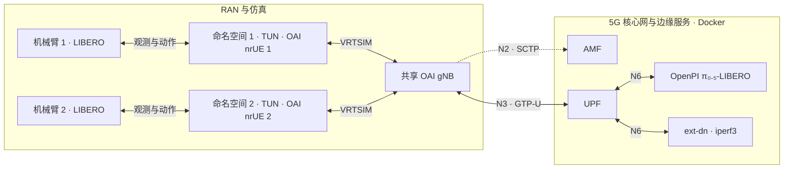

# Wireless VLA Testbed

面向无线具身智能实验的可复现部署项目。用同一个仓库搭建 OAI 5G 数据面、OpenPI π₀.₅-LIBERO 推理服务和 LIBERO/MuJoCo 仿真，从 UE 用户面发送机器人观测并接收动作序列。

项目负责人及实验平台设计 · [@lidabing1999](https://github.com/lidabing1999)

[快速开始](#快速开始) · [系统架构](#系统架构) · [双机部署](#双机部署) · [多终端与多机械臂](#多终端与多机械臂) · [运行实验](#运行实验) · [验证记录](#验证记录)

## 快速开始

单机部署需要 **Ubuntu 22.04 x86_64**、AVX2、Linux TUN/SCTP、NVIDIA GPU 和有 sudo 权限的账号。推理已在 NVIDIA L40S 上验证。建议预留至少 50 GB 磁盘空间，其中模型权重缓存约 12 GB。首次部署需要访问系统软件源、GitHub、镜像仓库、Python 软件源和 OpenPI 权重存储。

```bash
git clone https://github.com/lidabing1999/wireless-vla-testbed.git
cd wireless-vla-testbed
./bin/lab deploy --smoke
```

首次运行生成本地站点配置，安装 Docker、Compose 插件及 NVIDIA Container Toolkit，拉取固定版本的源码和镜像，编译 gNB/UE，并准备仿真环境与 π₀.₅ 服务。启动后，`--smoke` 会通过 UE 用户面运行一次放碗回合，把结果、录像和计时记录写入 `runs/`。

- 默认使用 GPU `0`。首次部署可传 `--gpu 1` 或 GPU UUID，并通过 `--jobs 8` 指定编译并行度。
- 若驱动安装提示重启，重启后重跑同一条部署命令。权重会在策略服务首次启动时下载并缓存。
- OAI 源码由子模块下载到 `vendor/oai/`。编译完成后，**gNB 在 `.state/ran/build/nr-softmodem`，UE 在 `.state/ran/build/nr-uesoftmodem`**。

## 系统架构



gNB 和 UE 是 Linux 原生进程。仿真客户端使用 Python 虚拟环境，并在 UE 网络命名空间内发起推理请求。核心网和策略服务通过 Docker Compose 运行。单机部署时，gNB 通过本机 Docker bridge 接入核心网；双机部署时，N2/N3 经过 IPIP 隧道，gNB 和 UE 仍位于同一台主机。

## 配置与分组件部署

`local/site.json` 保存拓扑、GPU、网段和匹配的实验 UE 订阅。首次部署自动生成，后续重启和单独重装组件使用同一份配置。如果主机上的其他服务已占用默认网段或端口，可以先配置可用的网段和端口。

```bash
./bin/lab init --topology single --bridge-subnet 172.30.218.0/26 --policy-host-port 18825 --gpu 0
./bin/lab plan
./bin/lab deploy --smoke
```

单机默认使用 OSMesa 无头渲染。需要 EGL 时，可把站点文件中的 `mujoco_gl` 改为 `egl`。选择其他站点文件时，把 `--site /path/to/site.json` 放在子命令前。

| 组件或操作 | 命令 |
| --- | --- |
| 编译 gNB、UE 和 VRTSIM | `./bin/lab deps ran`，然后运行 `./bin/lab prepare ran` |
| 部署核心网 | `./bin/lab deploy core` |
| 在核心网 bridge 上部署 OpenPI | `./bin/lab deploy edge` |
| 安装仿真并检查渲染 | `./bin/lab deploy sim` |
| 启动 gNB 和 UE | `./bin/lab deploy ran` |
| 分开调试 gNB 和 UE | 核心网就绪后运行 `sudo ./bin/lab network ran`，再在两个终端依次运行 `sudo ./bin/lab radio gnb` 与 `sudo ./bin/lab radio ue` |
| 查看运行状态 | `./bin/lab status ran`、`./bin/lab status core`、`./bin/lab status edge` |

`deploy` 用 systemd 瞬态服务管理 gNB 和 UE。切换到前台调试前先运行 `./bin/lab down ran`。整套停止时依次执行 `down ran`、`down edge`、`down core`，MySQL 数据卷和权重缓存会保留。主机重启后可重复执行部署命令。同一台主机同时启动一组 VRTSIM modem。

## 双机部署

两台主机需要互通 IPv4 并放行 IPIP（IP 协议号 4）。核心网主机使用 Docker 的 iptables 后端。把下面的示例地址换成实际互通地址，只生成一次站点文件，并复制到两台主机各自仓库的 `local/site.json`。复制后的文件权限保持为 `0600`。

```bash
./bin/lab init --topology dual --ran-ip 192.0.2.10 --edge-ip 192.0.2.20 --gpu 0
./bin/lab plan
```

**核心网与 GPU 主机**

```bash
./bin/lab deploy core
./bin/lab deploy edge
```

**RAN 与仿真主机**

```bash
./bin/lab deploy sim
./bin/lab deploy ran
./bin/lab sim probe
./bin/lab sim run bowl
```

`deploy core` 和 `deploy ran` 分别配置本端 IPIP 隧道。只替换 RAN 时，继续使用与原核心网数据库匹配的 IMSI、K 和 OPc。

## 多终端与多机械臂

每台机械臂对应一个独立的 LIBERO/MuJoCo 场景、一个 OAI nrUE 进程、一份移动用户订阅和一个网络命名空间。各 UE 接入同一个 gNB，经各自的 PDU 会话访问同一台 π₀.₅ 服务。这样可以分别测量多台机械臂竞争无线和推理资源时的控制表现。每个场景有自己的物体和任务判定。

新站点在 `lab init` 时添加 `--ue-count 2 --mujoco-gl egl`，然后按双机部署步骤启动。已有站点可以保留主 UE 的订阅和数据库，按下面的顺序扩容。

1. 在保存站点配置的一端运行 `./bin/lab ues 2`，把生成的同一份 `local/site.json` 安全复制到另一端，权限设为 `0600`。重复执行相同数量会保留已有订阅。
2. 在核心网主机运行 `./bin/lab subscribers`，将新增订阅加载到正在运行的数据库。
3. 在 RAN 主机等待当前实验结束，依次执行 `./bin/lab down ran` 和 `./bin/lab up ran`，让 gNB 和全部 nrUE 使用新配置。

在 RAN/仿真主机运行以下命令。任务按 UE 编号排列，给一个任务时所有 UE 运行该任务。

```bash
./bin/lab sim probe --ue 1
./bin/lab sim probe --ue 2
./bin/lab sim multi bowl
./bin/lab sim multi bowl drawer --seed 7 --init-state 0
./bin/lab sim run bowl --ue 2 --clock realtime
```

`sim multi` 等待所有场景初始化后，用同一个单调时钟起点按 **20 Hz** 推进。每台臂最多有一个在途请求，动作队列用完时发送最新观测。等待期间每步执行零位姿增量并维持上一夹爪指令。新动作块抵达后在下一个可用控制步执行，默认连续采用前 5 个动作。EGL 用于离屏渲染。每步实际耗时和漏掉的周期由运行时记录。

预热 10 步后，策略动作和等待动作都计入任务步数上限。放碗默认 300 步，即准时运行时有 15 秒完成；抽屉默认 520 步，对应 26 秒。用 `--max-control-steps N` 设置统一的任务预算，`--timeout` 单独限制进程墙钟运行时间。比较完成率时应固定任务预算、初始状态和重规划步数。

| 多机臂运行输出 | 用途 |
| --- | --- |
| `runs/<组>/summary.json` | 各 UE 地址、任务、退出码、TUN 上下行字节增量、全部机械臂同时运行的时间 |
| `ue-N/<回合>/timing.json` | 物理步数、保持与策略动作数、步间隔及推理往返的中位数与 P95、实时因子、漏周期和超期步数 |
| `ue-N/<回合>/control.jsonl` 与 `trace.jsonl` | 每步的计划/实际时刻、动作来源、请求编号、观测采集完成时刻及推理返回时刻，单位为本机单调时钟纳秒 |
| `ue-N/<回合>/user-plane.json`、任务 JSON 与 MP4 | 每个 TUN 的起止计数器、LIBERO 目标判定与回放 |

单臂退出码 `0` 表示任务成功，`2` 表示回合正常结束但未达成目标。已有端到端实测规模为 2 UE / 2 臂。固定 OAI 版本允许配置最多 16 个 UE 槽位，更大规模的实际容量取决于主机和负载。

## 运行实验

```bash
# 确认到策略服务的流量经过 UE TUN，再做双向吞吐探测
./bin/lab sim probe --throughput

# 固定任务、初始状态和随机种子
./bin/lab sim run bowl --init-state 1 --seed 7
./bin/lab sim run two-objects
./bin/lab sim run drawer

# 在能直接访问策略服务的主机上做直连对照
./bin/lab sim run bowl --host 127.0.0.1 --port 8000
```

| 任务 | LIBERO suite | Task ID |
| --- | --- | ---: |
| 放碗到炉灶 `bowl` | `libero_goal` | 1 |
| 两物入篮 `two-objects` | `libero_10` | 0 |
| 放碗入抽屉并关上 `drawer` | `libero_10` | 3 |

每个回合目录包含 `condition.json`、任务结果 JSON、录像、关键帧和 `trace.jsonl`。默认使用初始状态 0、种子 7，每次执行返回动作序列的前 5 步。`sim run` 默认沿用阻塞模式，等待推理期间仿真停步。单臂和直连对照可显式传入 `--clock realtime`，使用与 `sim multi` 相同的时钟和等待动作。

前台 gNB 支持 `--profile full`、`--profile ul32`、`--profile dl4`。基线载波配置为 106 PRB。`ul32` 保留连续上行 PRB 0–31 和上侧 PRB 98–105，`dl4` 将 gNB 下行 MCS 上限设为 4。切换档位需要重新启动 gNB 和 UE。

## 版本与缓存

| 路径 | 内容 |
| --- | --- |
| [`bin/lab`](bin/lab) · [`lab/`](lab/) | 部署入口、主机依赖、组网和运行管理 |
| [`ran/`](ran/) · [`.gitmodules`](.gitmodules) | gNB/UE 配置模板及 OAI、ASN.1、SIMDe 等源码引用 |
| [`core/compose.yaml`](core/compose.yaml) | 核心网服务及固定镜像摘要 |
| [`edge/`](edge/) · [`edge/requirements.lock`](edge/requirements.lock) | OpenPI 推理镜像和带 SHA-256 的依赖锁 |
| [`sim/`](sim/) · [`sim/requirements.lock`](sim/requirements.lock) | LIBERO 任务、MuJoCo 验证和仿真依赖锁 |
| [`experiments/`](experiments/) | 逐请求与逐仿真步计时脚本 |

部署器会按组件初始化源码子模块。也可以事先运行 `git submodule update --init --depth 1`。OpenPI、LIBERO 或 LeRobot 的 Git 下载失败时，部署器会自动获取同一提交的 GitHub 源码归档。

<details>
<summary>镜像站与已有缓存</summary>

| 配置 | 用途 |
| --- | --- |
| `VLA_DOCKER_MIRROR` | 指定可用的 HTTPS Docker Hub 镜像站，保留原镜像摘要。配置需要重启 Docker，适合首次部署或维护窗口。 |
| `VLA_MODEL_CACHE` | 指向已有 OpenPI 权重缓存。默认路径为 `.state/edge/model-cache`。 |
| `VLA_POLICY_IMAGE` | 复用本地兼容镜像。镜像需要在容器内监听 8000 并提供 `/healthz`。 |
| `VLA_POLICY_WHEELHOUSE` · `POLICY_PIP_INDEX` · `POLICY_WHEEL_ORIGIN` | 使用已有 wheel 缓存或镜像源，推理依赖仍按锁校验 SHA-256。 |
| `VLA_SOURCE_ARCHIVES` | 复用 OpenPI、LIBERO 和 LeRobot 的 GitHub 源码归档。文件名需为 `<组件>-<commit>.tar.gz`。 |

</details>

<details>
<summary>常见问题</summary>

| 现象 | 检查 |
| --- | --- |
| gNB 或 UE 启动失败 | 查看 `./bin/lab status ran`、`sudo journalctl -u wireless-vla-radio.service` 和 `.state/ran/logs/`。使用自定义项目名时，替换服务名前缀。 |
| UE 已注册，但推理连不上 | 执行 `./bin/lab sim probe` 检查 `oaitun_ue1` 和策略健康。边缘主机可单独通过 `curl -fsS http://127.0.0.1:8000/healthz` 验证模型服务，并按站点调整回环端口。 |
| 新站点 UE 无法通过鉴权 | 核对核心网数据库与 `local/site.json` 的 IMSI、K、OPc。要使用新订阅时，以新项目名初始化独立数据库卷。 |
| 核心网 bridge 或回环端口冲突 | 在首次启动前使用 `init` 指定 `--project`、`--bridge`、`--bridge-subnet` 和 `--policy-host-port`。 |

</details>

站点配置、编译产物、模型缓存、运行结果和抓包默认保留在本地，Git 忽略 `local/`、`.state/`、`runs/`、`*.pcap` 及 `*.pcapng`。

## 验证记录

| 验收项 | 已观察结果 |
| --- | --- |
| 从空白 Ubuntu 虚拟机自举 | 自动安装 Docker Engine 与 Compose 插件并启动 daemon。测试网络到 Docker Hub 的连接被重置，冷拉镜像需要可达的 registry 或镜像站。 |
| RAN 清洁构建 | 从 Git 子模块取得 OAI、SIMDe 和 ASN.1 编译器，并在 Linux 上编译 gNB、UE 与 VRTSIM。 |
| 单机 UE 用户面闭环 | 2026-11-25 建立 PDU 会话，通过 `oaitun_ue1` 访问 OpenPI 并完成放碗回合，生成 MP4 和 18 条推理请求记录。此次实测复用了 NVIDIA 驱动、固定核心网镜像和模型权重缓存。 |
| 双机 UE 用户面闭环 | 2026-11-25 在 RAN 主机编译 gNB 和 UE，运行 LIBERO/MuJoCo，经 IPIP 接入另一台主机上的核心网和 π₀.₅。固定种子 7、初始状态 0 的放碗回合成功，推理期间观测到了双向 N3 流量。 |
| 双 UE / 双 EGL 机械臂 | 2026-11-26 两个 UE 在同一 gNB 上建立各自的 PDU 会话。两次并发放碗均为两臂成功。第二次两臂共同运行 10.66 秒，步间隔 P95 分别为 50.35 / 50.34 ms，均无漏周期。另两次并发放碗与抽屉实验中，放碗均成功，抽屉在 520 和 900 步预算内均未完成。 |

初次安装 NVIDIA 驱动的流程仍需在带物理 GPU 的空白主机上验证。

## 上游项目与许可证

- 无线与核心网基于 OpenAirInterface。仓库中标注 CSSL 的 OAI 派生模板与数据库文件沿用其许可证。 [Duranta OpenAirInterface](https://github.com/duranta-project/openairinterface5g) · [OAI 5G Core](https://gitlab.eurecom.fr/oai/cn5g/oai-cn5g-fed) · [OAI CSSL](licenses/OAI-CSSL) · [OAI NOTICE](licenses/OAI-NOTICE)
- 单任务 LIBERO 客户端改编自 Physical Intelligence 的 OpenPI 示例，沿用 Apache-2.0。LIBERO、MuJoCo、第三方镜像和模型权重遵循各上游条款。 [OpenPI](https://github.com/Physical-Intelligence/openpi) · [LIBERO](https://github.com/Lifelong-Robot-Learning/LIBERO) · [OpenPI LICENSE](licenses/OpenPI-LICENSE)
- 主机安装采用 Docker 和 NVIDIA 的官方软件源。 [Docker Engine](https://docs.docker.com/engine/install/ubuntu/) · [Docker Hub 镜像站](https://docs.docker.com/docker-hub/image-library/mirror/) · [NVIDIA Container Toolkit](https://docs.nvidia.com/datacenter/cloud-native/container-toolkit/latest/install-guide.html) · [Ubuntu NVIDIA 驱动](https://ubuntu.com/server/docs/how-to/graphics/install-nvidia-drivers/)
