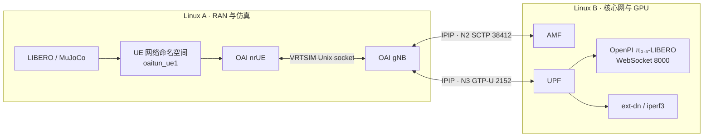

# 无线具身智能双机实验平台

用同一个仓库部署 OAI gNB、UE、5G 核心网、OpenPI π₀.₅-LIBERO 服务和 LIBERO/MuJoCo。仓库包含部署入口、实验组网参数、依赖锁和回合采集脚本。首次部署由 `bin/lab prepare` 下载对应组件的上游版本、镜像和 Python 依赖。OpenPI 首次启动时自动下载模型权重。



## 准备工作

- 推荐两台 Ubuntu 22.04 x86_64 服务器。Linux A 需要可用的 `/dev/net/tun`、AVX2 和 EGL 或 OSMesa。gNB 与 UE 共用同一台服务器，通过 VRTSIM 的 Unix socket 交换 IQ 数据。
- Linux B 需要 Docker Engine、Docker Compose v2、NVIDIA 驱动和 NVIDIA Container Toolkit。验证原平台使用 L40S。运行 `nvidia-smi -L` 选择 GPU UUID，或使用设备序号。预留模型约 12 GB、镜像构建与下载缓存额外约 20 GB 的磁盘。
- 两台服务器之间需要双向 IPv4 可达，并允许 IPIP，即 **IP 协议号 4**。主机防火墙使用 Docker 的 iptables 后端。检查站点的 Docker 网段和隧道网段与现有网络无重叠。
- 首次准备需要访问 GitHub、容器镜像仓库、Python 装包源和 OpenPI 模型存储。跨机的 SSH 文件传输走管理网络，实验推理走 UE 用户面。

## 首次部署

将仓库 clone 到两台机器。可在本机 checkout 里生成一次站点文件，再复制到两台服务器相应 checkout 的 `local/site.json`。以下两个地址是示例，换成 Linux A、B 用于互通的实际地址。

```bash
./bin/lab init --ran-ip 192.0.2.10 --edge-ip 192.0.2.20 --gpu 0
./bin/lab plan
```

`init` 生成匹配的实验 IMSI、K、OPc 和数据库密码，两端使用同一份文件。文件权限为 `0600`。第一次选定核心网项目名和凭据后保留配置，MySQL 数据卷跨重启保留。只重装 RAN 时，继续使用与现有核心网订阅匹配的 IMSI、K 和 OPc。可用 `--site /path/to/site.json` 或环境变量 `VLA_SITE` 选择其他站点文件，`--site` 放在子命令前。

### Linux B · 核心网与边缘服务

```bash
./bin/lab deps core
./bin/lab deps edge
./bin/lab doctor core
./bin/lab doctor edge
./bin/lab prepare core
./bin/lab up core
sudo ./bin/lab network core
./bin/lab prepare edge
./bin/lab up edge
curl -fsS http://127.0.0.1:8000/healthz
```

`prepare edge` 构建推理镜像，`up edge` 等待模型初始化完成。默认把权重缓存到 `.state/edge/model-cache`。迁移时可以设置 `VLA_MODEL_CACHE=/absolute/path` 指向已有 OpenPI 缓存，至少在 `up edge` 时使用同一路径。也可用 `VLA_POLICY_IMAGE` 指向本机已有的兼容镜像，`up edge` 会使用该镜像的默认命令，须能在容器内监听 `0.0.0.0:8000` 并提供 `/healthz`。

策略容器连到核心网 Docker bridge。主机回环端口用于本地检查，UE 走同一 bridge 上的策略容器地址。端口冲突时用 `init --policy-host-port` 设置回环端口。Compose 变量 `POLICY_PIP_INDEX` 和 `POLICY_WHEEL_ORIGIN` 分别选择 PyPI 索引和锁定大 wheel 的镜像站源站，后者需要兼容 `/packages/...` 路径。依赖仍接受 SHA-256 校验。已有部署的 PyPI wheel 缓存可用 `VLA_POLICY_WHEELHOUSE=/absolute/path` 传给 `prepare edge`，匹配文件仍按锁校验。

### Linux A · gNB、UE 与 LIBERO

```bash
./bin/lab deps ran
./bin/lab deps sim
./bin/lab doctor ran
./bin/lab doctor sim
./bin/lab prepare ran --jobs 4
./bin/lab prepare sim
./bin/lab sim check
sudo ./bin/lab network ran
sudo ./bin/lab radio both
```

`radio both` 在同一个前台进程里先启 gNB 再启 UE。也可以用不同终端依次执行 `sudo ./bin/lab radio gnb` 和 `sudo ./bin/lab radio ue`。日志位置在启动时打印。Ctrl+C 结束该命令启动的 modem。裸机仿真默认使用 EGL，遇到无头渲染设备权限问题可在 Linux A 的站点文件中将 `mujoco_gl` 改为 `osmesa` 后执行 `sim check`，结果计时应记录渲染后端。

保持 radio 终端运行，在第二个终端执行：

```bash
./bin/lab sim probe
./bin/lab sim run bowl
```

`sim probe` 先确认去往策略端点的路由走 `oaitun_ue1`，再从该 namespace 请求 `/healthz`。可加 `--throughput` 测 ext-dn 的上行和下行吞吐。它与回合推理可分别运行，方便区分 PDU 会话、用户面和策略问题。

## 实验与恢复

| 操作 | 命令 |
| --- | --- |
| 查看当前站点拓扑 | `./bin/lab plan` |
| 查看核心网和边缘服务状态 | `./bin/lab status core`、`./bin/lab status edge` |
| 更换任务 | `./bin/lab sim run two-objects` 或 `./bin/lab sim run drawer` |
| 更换起始状态或随机种子 | `./bin/lab sim run bowl --init-state 1 --seed 7` |
| 用非 UE 路径做推理对照 | `./bin/lab sim run bowl --host 127.0.0.1 --port 8000`，需先建立可达的直连端点或 SSH 转发 |
| 重新启动时切换无线条件 | 结束当前 radio 后运行 `sudo ./bin/lab radio both --profile ul32` 或 `--profile dl4` |

`full` 是原 106 PRB 载波配置。 `ul32` 保留连续上行 PRB 0–31 和上侧 PRB 98–105，复用原实验保留 PUCCH 的口径。 `dl4` 将 gNB 下行 MCS 上限设为 4。默认种子 7、初始状态 0、每次执行动作序列前 5 步，策略最多返回 10 步。回合输出在 `runs/`，包含任务结果 JSON、视频、关键帧和客户端逐请求/逐步的 `trace.jsonl`。客户端等待推理时暂停仿真步进，墙钟时间与仿真时间要分别统计。

- Linux B 重启后先确保 `up core` 和 `up edge` 就绪，再执行 `sudo ./bin/lab network core`。Linux A 重启后执行 `sudo ./bin/lab network ran` 并启动 radio。动态 IPIP 链路、窄范围防火墙规则和 UE 命名空间在运行时重建。
- `./bin/lab down edge` 和 `./bin/lab down core` 停止容器并保留数据库卷与模型缓存。更换实验 IMSI、K、OPc 或数据库密码时用新的项目名和空数据库卷；健康检查会核对 MySQL 内实际注册的订阅。
- 如需与现有平台并行运行，另选 `--project`、`--bridge-subnet`、`--bridge`、`--tunnel-subnet`、`--tunnel`、`--ue-namespace`、`--policy-host-port`。同一台 Linux A 在同一时刻仅启动一组 modem。基于同一个 underlay 地址对新建并行 IPIP 隧道可能冲突，切换链路前应沿用实际网络管理流程。
- `local/`、`.state/`、`runs/` 和抓包在 Git 忽略规则中。模型缓存、Python 环境和编译产物都可由本仓库再次构建。此项目覆盖数据面推理和压测，现有测试床的 IMS 语音容器属于独立链路。

## 源码与版本

源码锁见 [config/sources.json](config/sources.json)。核心网镜像包含实验平台使用的 OAI CN5G v2.2.1 与 MySQL 9.6 摘要，见 [core/compose.yaml](core/compose.yaml)。仿真使用 Python 3.10、MuJoCo 3.2.3、robosuite 1.4.1 和 PyTorch 2.2 CPU。重装时可用 `VLA_SOURCE_ARCHIVES=/absolute/path` 指向已下载的 OpenPI、LIBERO 或 LeRobot GitHub 源码 tarball 缓存，命名为 `<组件>-<commit>.tar.gz`。边缘服务使用 Python 3.11.9、JAX 0.5.3 和 PyTorch 2.7.1，见 [edge/requirements.lock](edge/requirements.lock)。

实验的 gNB/UE 使用 [Duranta OAI VRTSIM 源码](https://github.com/duranta-project/openairinterface5g/commit/88245ba846bd046720eb3503e17c297ec80c1606)。OpenPI 与 LIBERO 锁定为部署时的上游提交。[OpenPI](https://github.com/Physical-Intelligence/openpi/commit/215abfb217dbac7d5f1273282331b9b1866c0479) · [LIBERO](https://github.com/Lifelong-Robot-Learning/LIBERO/commit/f78abd68ee283de9f9be3c8f7e2a9ad60246e95c)

OAI 派生的配置和数据库模板使用 [OAI CSSL](licenses/OAI-CSSL)。单任务 LIBERO 客户端基于 Apache-2.0 OpenPI 示例，见 [OpenPI LICENSE](licenses/OpenPI-LICENSE)。上游代码、镜像和模型的许可证以各发布方为准。

## 验证记录

2026-11-24 在 Ubuntu 22.04 实验服务器的临时目录完成验证。

| 组件 | 验证结果 |
| --- | --- |
| RAN | 从锁定提交编译出 gNB、UE、VRTSIM 和运行库 |
| 5G 核心网 | 独立网段启动 AMF、SMF、UPF 等 9 个容器，全部通过健康检查 |
| 边缘服务 | 从依赖锁构建新镜像，复用模型缓存启动并通过 `/healthz` |
| LIBERO/MuJoCo | 新装 Python 环境通过离屏渲染。经跨机 SSH 直连调用新构建的 OpenPI 容器完成放碗回合，生成结果、录像和分段计时 |

新项目的 IPIP 配置、PDU 会话和 UE 用户面回合仍需在拥有 sudo 权限的目标机上按首次部署流程验收。
